# Agent Quality Loop

## 1. 这个项目是什么

我参与过一个内部项目：给一个跑在真实业务里的对话 Agent 做质量平台。

当时团队的状态是：线上每天都有失败的对话，测试同学能看出"这句答得不对"，但很难说清楚它为什么错、改到什么程度才算修好。提示词改一版，靠人肉找几条会话重跑，觉得差不多了就上线；过几天同样的问题又出现，分不清是新问题还是老问题没修干净。评分散落在观测系统里，口径也不统一：有时一轮有多条评分，有时评分还没写回来。

平台要解决的就是这条链：把真实运行记录变成**可回放的失败样本**，把提示词修改变成**可验证的候选**，把验证结果变成**能复盘、敢写局限的报告**。

具体做的事情：

1. 从 Langfuse 只读拉取真实轨迹、数据集和评分；
2. 把失败轮次连同评分证据、历史消息、回放主键固化成 BadCase；
3. 按测试版本归集 BadCase，建"修复批次"；
4. 把批次里的失败轮次逐条交给算法侧的优化器，拿回提示词候选；
5. 通过回放/资产后台，把当时那次模型请求原样重发——只替换主提示词——连续验证三次；
6. 3/3 通过才接受，资产前进一步，然后重测剩余失败轮次；
7. 整集回归，出报告；候选只保存为草稿，发布由人决定。

这个平台后来真的在内网跑起来了：后端两万多行 Python，前端两万多行 TypeScript，五十张表，一千二百多个测试，部署在一台内网服务器上，测试和算法两个团队用它联调修复闭环。

它不完美，而且这些不完美是明确写下来的：

- 回放只能替换主提示词，所以技能、工具描述、参数描述的改动**无法被验证**，平台会整份拒收，不记成"已验证"；
- 执行器是单进程线程，重启会中断批次；
- Langfuse 没有轨迹索引、不给总数、会静默忽略未知参数，平台能看到的永远是一个窗口；
- 上游按来源 IP 拦截时，平台只能报"被网关拒绝"，绕不过去。

这份 README 讲的就是上面这些东西是怎么接起来的。**代码不在这个仓库里**：下面的 demo 是按同样思路重写的虚构版本，内部实现、地址、凭据和真实数据都没有带出来。

> 第 4 节的链路按可公开描述的程度重写：保留协议形状、状态语义和取舍，省略内部地址、凭据与对端实现。示例中的域名、ID、任务号都是占位符。截图来自内部平台的隔离演示项目，数据为合成，侧栏与顶栏已裁掉。

阅读建议：想看系统怎么接起来，直接读第 4 节；想跑一个不依赖内部系统的版本，读第 8 节；想知道哪里没做到，读第 9 节。

---

## 2. 我们做了什么

### 2.1 一条完整的修复闭环

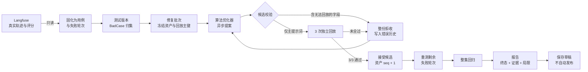

每一步都有明确的"不做什么"：

| 环节 | 做 | 不做 |
| --- | --- | --- |
| 读 Langfuse | 只读轨迹、数据集、评分 | 不写回、不重新判分 |
| 固化 BadCase | 冻结证据、历史、回放主键 | 不把没有主键的轮次当作可验证 |
| 提候选 | 原样存档请求体，按 `task_id` 幂等 | 不在结果未知时自动重发 |
| 校验候选 | 只接受可被回放注入的字段 | 不把"部分验证"记成"已验证" |
| 回放验证 | 3 次独立、逐次记录 | 不取多数票、不隐瞒失败 |
| 接受资产 | 每次前进写快照 | 不把资产当成可变的"最新一行" |
| 回归 | 覆盖全部可回放轮次 | 不把不可回放轮次混进通过率 |
| 出报告 | 写终态、停止原因、局限 | 不用 `stalled` 冒充"接近成功" |

### 2.2 平台能力

| 域 | 能力 |
| --- | --- |
| 身份与项目 | 本机管理员初始化、登录、项目隔离、成员角色（管理员/编辑者/只读）、审计事件 |
| 连接与凭据 | Agent / Langfuse / 模型网关 / 回放后台 / 算法五类连接；凭据加密、绑定、验证、失效 |
| 观测接入 | Langfuse 只读验证、数据集与样本、轨迹列表/详情/概览、评分详情 |
| Trace 工作台 | 平铺步骤视图、工具排行、耗时/token、按工具筛选、快照导入导出、公开分享、两条轨迹对比 |
| 用例与评测 | 单轮/多轮用例、用例集、数据集、语料 Excel 导入、评测运行、Judge、报告 |
| BadCase | 测试版本、失败轮次归集、指纹去重、证据链、重扫、忽略/标记修复 |
| 会话导入 | 从 Langfuse 扫描会话 → 多轮用例 → 按评分判定失败轮次 → 可移除导入 |
| 资产 | 从回放后台读取主提示词、技能、工具；快照与哈希；资产演进 |
| 修复批次 | 逐 BC 提案、候选校验、3 次回放、接受、重测剩余、整集回归、停止/预算、报告 |
| 算法对接 | 异步任务提交/轮询、幂等、租约、600 秒 TTL、原始请求/响应存档、能力探测 |
| 集成接口 | 算法/外部程序入站接口、范围令牌、BadCase 导出与结果回传 |
| 诊断运维 | JSONL 诊断日志、请求编号、联调自检、算法任务复盘、部署 smoke |

### 2.3 规模与形态

| 项 | 数值 |
| --- | --- |
| 后端 | 约 22,000 行 Python（FastAPI 单应用，167 个路由） |
| 前端 | 约 25,000 行 TypeScript/TSX（React 19 + antd 5） |
| 数据 | 50 张表；31 份 SQLite 迁移 + 18 份 Alembic 版本 + MySQL schema |
| 测试 | 58 个测试文件、1,254 个用例；另有浏览器端到端脚本 |
| 文档 | 53 份设计、契约、部署与诊断文档 |
| 部署 | 单台内网服务器；nginx + systemd + SQLite（可选 MySQL）；单实例执行器 |

### 2.4 真实系统的界面

以下三张来自内部平台的隔离演示项目（数据为合成，侧栏与顶栏已裁掉；平台名、项目 ID 和业务名不在图内），不是这个仓库的 demo。正文里放的是聚焦裁剪，点击图片可看完整原图。

**BadCase 池与修复批次**：失败轮次、评分、来源、可回放标记，以及批次的历史结果。

[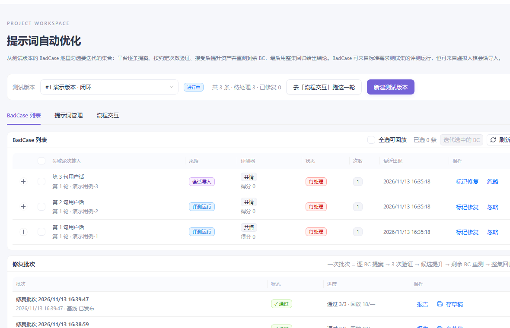](media/real-badcase-pool.png)

**修复控制台**：逐 BC 的尝试次数、3 次验证结果、当前资产，以及底部"与算法的沟通"任务账本。

[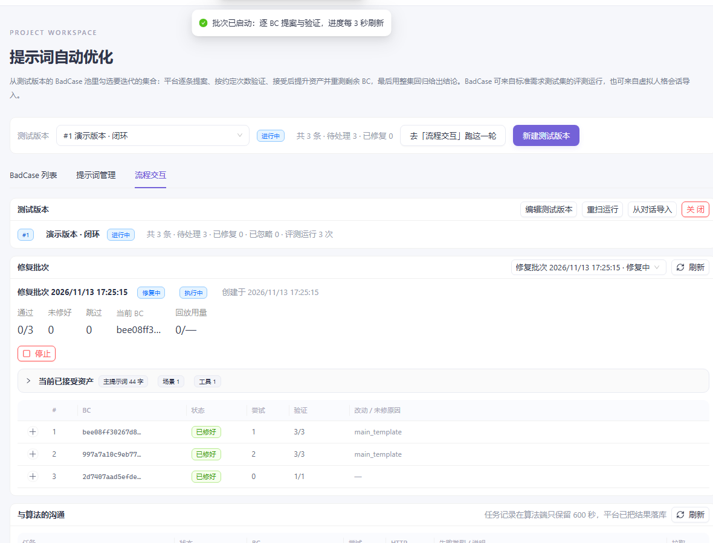](media/real-repair-console.png)

**Trace 工作台**：按步骤展开模型决策、工具调用、token、评分；连续调用会重发越来越长的上下文，因此单独标注系统提示词重复量。

[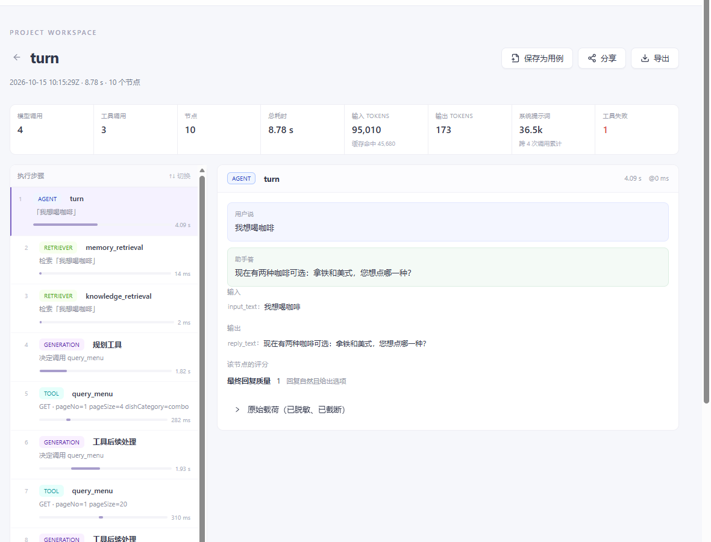](media/real-trace-workbench.png)

---

## 3. 总体架构

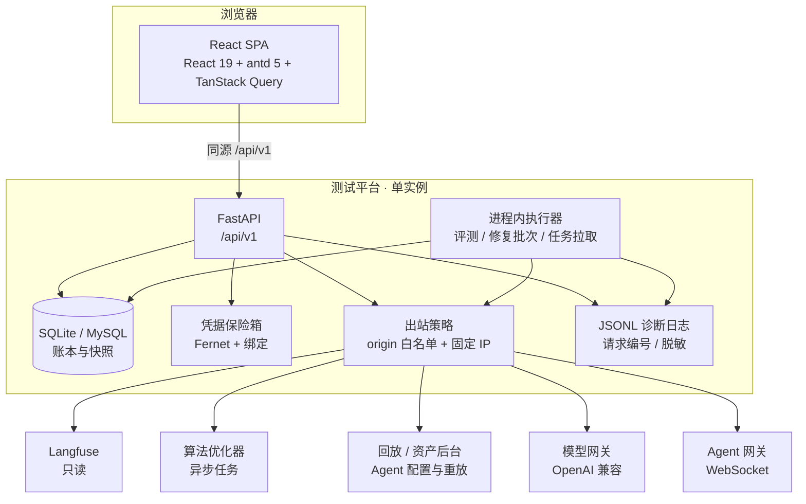

- **前端**：React SPA，Vite 构建；API 一律走同源相对路径，没有跨域。
- **后端**：FastAPI 单应用，路由、鉴权、中间件、领域模块都在一个进程里；SQLite 默认，MySQL 通过 `PLATFORM_DB_URL` 切换。
- **后台执行**：评测、修复批次、算法任务拉取都在进程内线程里跑；重启中断，靠账本和"继续"恢复。这是已知限制，不假装是分布式系统。
- **数据**：所有状态先落库再推进；外部请求的原样请求体/响应体也落库，复盘不需要再调上游。
- **部署**：nginx 暴露 80，静态文件指向 SPA 构建产物，`/api/` 反代到只监听回环的 uvicorn。

---

## 4. 四条链路

四条链路各自负责一段，失败语义完全不同，不能混在一起处理：

| 链路 | 方向 | 负责 | 失败语义 |
| --- | --- | --- | --- |
| 前端 → 平台后端 | 浏览器 → 服务端 | 会话、权限、页面数据 | 4xx 业务拒绝，5xx 带请求编号 |
| 平台后端 → Langfuse | 出站只读 | 轨迹、数据集、评分 | 凭据错误 / 网关拦截 / 上游静默忽略参数 |
| 平台后端 ↔ 算法 | 出站异步 | 生成候选 | 排队、执行、过期、暂不可用 |
| 平台后端 ↔ 回放后台 | 出站 | 验证候选、保存草稿 | 回放失败、无幂等、CAS 冲突 |

### 4.1 前端 → 测试平台后端

**技术形态**：React 19 + antd 5 + react-router 7 + TanStack Query；Vite 开发服务器只做本地开发，生产是 nginx 托管静态文件。所有请求走 `/api/v1`，与页面同源。

**认证**：

1. 首次启动进入 `/setup` 创建本机管理员，没有默认账号密码；
2. 登录成功后写会话 Cookie：`HttpOnly`、`SameSite=Strict`、`Path=/api`；
3. 登录限流按来源地址计数；反向代理后必须显式开启可信代理，否则全站共用一个桶；
4. HTTPS 部署才允许开启 secure cookie。

**写操作防护**：浏览器发起的非 GET 请求必须同时满足 `Origin` 命中允许列表、带 `X-Studio-Request: 1`。程序间接口（`/integration/*`）不走 Cookie，用独立令牌，不复用浏览器的 CSRF 规则。

**错误契约**：所有业务错误返回同一个信封，前端 toast 直接展示 `message` 和 `requestId`：

```json
{
  "error": {
    "code": "NO_REPAIRABLE_BC",
    "message": "选中的失败轮次都没有可回放主键",
    "requestId": "req_01J..."
  }
}
```

- 4xx 是业务拒绝，`code` 稳定；
- 5xx 才叫 `INTERNAL_ERROR`，响应里带异常类型和请求编号，完整堆栈只在服务端 JSONL 日志里；
- 每个请求只写一条日志，失败也在同一条里记录 `code`、`status`、`requestId`、耗时。

**页面数据策略**：轨迹载荷按需拉取，列表只读摘要；所有"覆盖了多少/共多少"都在响应里带范围，前端不自己猜总数。前端状态用 TanStack Query 管理，保存类操作会显示版本冲突，而不是静默覆盖。

**后端接口怎么组织**：`create_app()` 在启动时装配所有路由；输入用 Pydantic 模型，鉴权和项目成员校验走依赖注入；请求编号、CSRF、请求体上限、统一日志都在中间件里处理一次；领域模块不直接拼 HTTP 响应，而是抛稳定错误码，由统一异常处理器转成上面的信封。外部传输全部是注入点——生产走真实 HTTP，测试和 demo 走替身，路由、鉴权、落库仍是真实代码。新增一个外部系统时，先加传输接口和错误映射，再接业务。

**主要接口分组**（节选，省略统一前缀 `/api/v1`）：

| 分组 | 代表接口 |
| --- | --- |
| 身份 | `POST /api/v1/setup`、`POST /login`、`GET /session` |
| 项目 | `GET/POST /projects`、`GET/PUT /projects/{pid}` |
| 连接 | `GET /projects/{pid}/connections`、`PUT /connections/{kind}`、`POST /connections/langfuse/check` |
| 轨迹 | `GET /projects/{pid}/traces`、`/traces/aggregate`、`/trace-sessions/turns`、`/trace-snapshots` |
| 用例 | `GET/POST /projects/{pid}/cases`、`/case-sets`、`/datasets`、`/corpus` |
| 评测 | `POST /projects/{pid}/evaluations`、`GET /evaluations/{run_id}` |
| BadCase | `GET/POST /bc-cycles`、`GET /bc-items`、`POST /bc-items/{id}/replay-id` |
| 会话导入 | `POST /session-import/scan`、`POST /session-import`、`DELETE /session-imports/{sid}` |
| 修复 | `POST /repair-batches`、`POST /repair-batches/{id}/start`、`/stop`、`GET /report`、`POST /save-draft` |
| 算法 | `GET /algorithm-tasks`、`POST /bc-items/{id}/algorithm-task`、`POST /algorithm-tasks/{id}/sync` |
| 资产 | `GET /agent-config`、`GET /asset` |
| 自检 | `POST /integration-preflight`、`GET /health` |

一次"建批次 → 启动 → 轮询 → 报告"的调用顺序：

```text
POST /api/v1/projects/{pid}/bc-cycles/{cycle}/repair-batches
     { "bcIds": ["bc_...", "bc_..."], "maxAttempts": 3 }
     → 201 { "batchId": "batch_...", "status": "frozen", "queued": 2, "skipped": 1 }

POST /api/v1/projects/{pid}/repair-batches/{batchId}/start
     → 202 { "status": "running" }

GET  /api/v1/projects/{pid}/repair-batches/{batchId}
     → 200 { "status": "running", "counts": {...}, "items": [...] }

GET  /api/v1/projects/{pid}/repair-batches/{batchId}/report
     → 200 { "status": "converged", "stopReason": "...", "items": [...],
             "regression": {...}, "limitations": [...] }

POST /api/v1/projects/{pid}/repair-batches/{batchId}/save-draft
     → 200 { "saved": true, "baseRevision": 41 }
```

请求体字段名以真实契约为准；这里只保留形状。所有项目级资源都必须带 `pid`，服务端会校验当前用户对该项目的成员关系。

### 4.2 测试平台后端 → Langfuse（只读）

**目标**：把 Langfuse 当作事实来源，**只读**。平台不往里写评分、不重新判分，也不假设 Langfuse 的数据是完整的。

**连接配置**：项目级保存 `baseUrl`、外部项目 ID、API 契约版本（v3/v4）和项目级 Public/Secret Key。凭据加密后单独存，绑定三元组：

```text
projectId + baseUrl + externalProjectId
```

任何一项变化，旧凭据立即失效，必须重新录入。这样改连接地址不能把旧凭据发到别的主机。主密钥在数据库之外，必须和数据库成对备份；丢失后库里的凭据全部不可恢复。

**调用的接口**：

| 用途 | 接口 |
| --- | --- |
| 验证 key 与项目归属 | `GET /api/public/projects` |
| 数据集 | `GET /api/public/v2/datasets`、`GET /api/public/dataset-items` |
| 观测（轨迹来源） | `GET /api/public/v2/observations` |
| 评分 | `GET /api/public/v3/scores`（v3 部署用 `/api/public/v2/scores`） |

**v4 的关键差异**：内部部署是 `events_only` 模式，没有轨迹索引，`/api/public/traces` 等接口 404。所以一条"轨迹"不是一条记录，而是共享同一个 `traceId` 的一组观测，由平台按 `traceId` 聚合推导。上游也不返回总数，列表翻到哪算哪。实测这个 Agent 的轨迹是**平铺结构**（`maxDepth = 1`），所以工作台主视图是步骤列表，不是层级树。

另一个容易误导的地方：Langfuse 自己的评分器运行也会写回同一项目，实测占到记录总量的八成左右。直接对整库求"中位耗时"，既不描述 Agent，也不描述评分器。平台默认按类别分组展示，并标出每组覆盖了多少条。

**上游会静默忽略参数**：实测 `page`、`userId`、`fields=all` 等参数会被某些部署直接忽略。平台对每个筛选条件都做**回验**：请求里带了筛选，返回结果里必须真的生效；没生效就报错，而不是把未筛选的数据当筛选结果展示。这比"看起来有结果"重要。

**扫描上限**：会话导入从新到旧最多 6 页 × 100 条观测；深采样（token、工具成败）默认关闭，最多读最近 12 条；每个数据集首批最多 100 条。所有页面都必须显示"本次覆盖 N 条、是否读到末尾"，不能把样本当总体。

**统计口径**：耗时分位用最近秩法取实际观测值，不插值；被扫描截断的轨迹会让分位**低估**，界面标出受影响条数。连续调用会重发不断变长的上下文——实测一条 4 步轨迹的系统提示词有 28,621 字符，每步重发一次，四步累计 114,484 字符。工作台因此区分"与上一步相同"和"本步新增"，单独汇总重复量。

**403 的两种含义**：

| 响应体 | 含义 | 平台处理 |
| --- | --- | --- |
| JSON | Langfuse 自己的凭据/权限问题 | 报 `LANGFUSE_AUTH` 类错误，提示项目级 key |
| HTML（nginx/ALB/WAF） | 前置网关按来源 IP 拦截 | 报 `GATEWAY_BLOCKED`，提示加白出口 IP |

这个区分不是文字游戏：平台自己无法绕过对端网关的 IP 白名单，报错必须指向真正的责任方。

**出站安全**：所有上游请求走同一个策略入口：

1. origin 必须在 `config/platform-network.json` 登记（协议 + 主机 + 端口精确匹配）；
2. 解析后固定一个 IP，连接时用同一个 IP，防止 DNS 重绑定；
3. 非全局单播地址需要显式登记 CIDR，不能因为"看起来是内网"自动放行；
4. 不跟随重定向、不使用环境代理。

**冻结与分享**：评测结果写入时保存逐用例、逐轮的完整 JSON；"重扫"只读这份 JSON，不访问 Langfuse。分享不是给链接看原数据，而是创建时把当下数据投影成脱敏快照：移除 `userId`、`sessionId`，数据库只存令牌哈希，明文只显示一次，链接有有效期、可撤销，分享页不连上游。

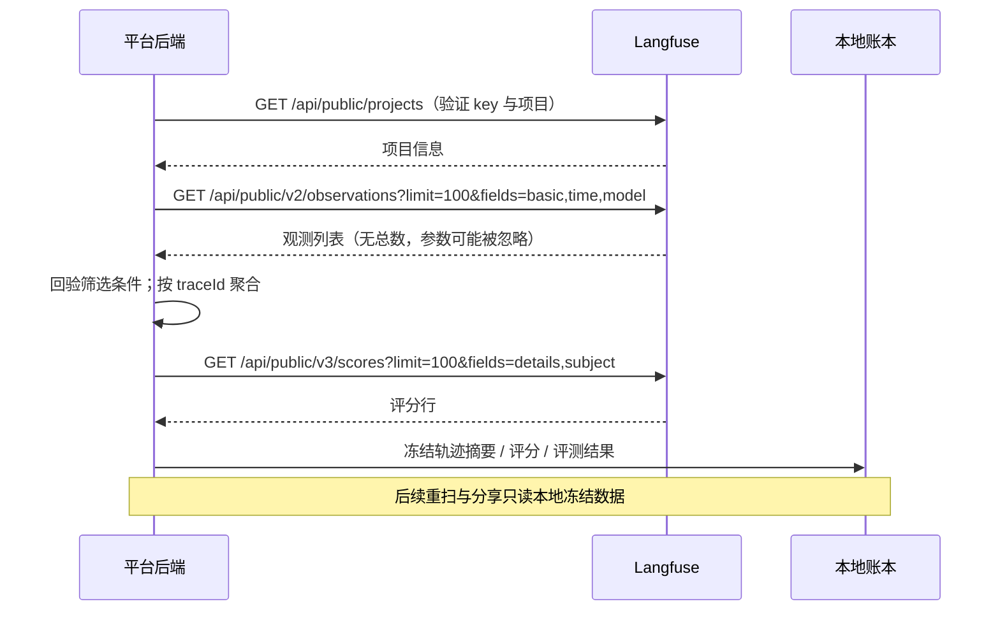

### 4.3 测试平台后端 ↔ 算法服务（异步提案）

算法侧是一个独立的 HTTP 服务，平台只负责提交任务、轮询终态、落库。两边靠一份冻结的异步任务契约通信（契约由平台与算法团队共同冻结，下面是可公开描述的形状）。

**契约形状**：

| 动作 | 请求 | 响应 |
| --- | --- | --- |
| 提交 | `POST {optimizer}/prompt-optimization/tasks` | `202 { task_id, status }`，`Location` 指向查询地址 |
| 查询 | `GET {optimizer}/prompt-optimization/tasks/{task_id}` | `queued / running / succeeded / failed` |
| 失败 | 同上 | `error.detail.type`: `proposal_failed` / `execution_error` / `timeout` / `execution_lost` |
| 过期 | 同上 | `404`，表示任务不存在或已过期；同一个 `task_id` 可以重新提交 |
| 暂不可用 | 同上 | `503`，继续轮询，尊重 `Retry-After` |

**`task_id` 是幂等键**：平台为"批次 + BC + 尝试次数"生成一个 ID（只含字母数字和 `-`）。网络结果不明时，用**相同的 `task_id` + 原样请求体**重试；一次新的业务尝试必须换新 ID。因为"可选字段是否显式提供"也参与幂等比较，平台必须把首次提交的 body 原文落库，不能重新组装后再序列化。

**输入**：

```json
{
  "task_id": "batch01-bc03-a2",
  "baseline": {
    "main_template": "……完整主提示词，保留模板变量……",
    "skills": { "结束沟通.j2": "……技能正文……" },
    "tools": [
      {
        "type": "function",
        "name": "query_room_detail",
        "description": "查询房间详情",
        "parameters": { "type": "object", "properties": {}, "required": [] }
      }
    ]
  },
  "used_skill_names": ["结束沟通.j2"],
  "history": [
    { "role": "user", "content": "我们有四个人，能换一间带白板的吗？" },
    { "role": "assistant", "content": "已为您改到 5 号研讨间。" }
  ],
  "error_history": [
    { "analysis": "未核实容量与设备，请修正这一行为。" }
  ]
}
```

**输出**：`result.candidate` 是与 `baseline` 同构的完整资产，`result.changes` 是逐条修改方案：

```json
{
  "changes": [
    {
      "kind": "main_template",
      "target_id": "prompt.main",
      "original_text": "……",
      "replacement_text": "……",
      "reason": "补充改约前的核对步骤"
    }
  ],
  "candidate": {
    "main_template": "……",
    "skills": {},
    "tools": []
  }
}
```

算法第 4 版支持四类 `kind`：`main_template`、`skill_template`、`tool_description`、`parameter_description`，并返回 `target_id`；`proposal_failed` 时还会给结构化的 `validation_errors`（`code`、`message`、`change_index`、`target_id`、`match_count`、`matching_targets`）。

**平台侧的处理**：

1. 提交后把请求体原文写成一行 `algorithm_tasks`，状态、轮询次数、响应原文都留着；
2. 后台拉取器每 1 秒扫一次未终态任务，终态结果**必须在 600 秒内落库**——上游只保留 600 秒，查询不续期；
3. `failed` 不自动重试，由编排决定换新 `task_id`，并计入该 BC 的尝试预算；
4. 候选先过**字段白名单**：只接受 `main_template`。出现 `skill_template`、`tool_description`、`parameter_description` 中的任何一个，整份拒收，把原因写进该 BC 的 `error_history`，下一次提案原样带上；
5. `validation_errors` 压成一行写进错误历史，原始响应仍完整保存在账本里。

字段白名单不是保守，是唯一诚实的选择：回放只替换主提示词，其他字段即使被"接受"也无法被验证。把没验证的东西记成已验证，比不修更糟。

```mermaid
sequenceDiagram
    participant EX as 修复编排
    participant OPT as 算法优化器
    participant DB as 任务账本

    EX->>DB: 读取当前资产 + history + error_history
    EX->>OPT: POST /prompt-optimization/tasks (task_id, 原样 body)
    OPT-->>EX: 202 { task_id, status: queued }
    EX->>DB: 存档请求体原文
    loop 每 1 秒
        EX->>OPT: GET /prompt-optimization/tasks/{task_id}
        OPT-->>EX: queued / running
    end
    OPT-->>EX: succeeded { result.candidate }
    EX->>DB: 600 秒内落库 result
    alt 候选含不可验证字段
        EX->>DB: 整份拒收，error_history += 原因
    else 仅主提示词
        EX->>EX: 进入 3 次回放验证
    end
```

**联调经验**：契约文档和对端实际部署可能不一致，平台用 `GET /openapi.json` 做零成本能力探测，不靠口头版本号判断；测试环境没有鉴权，生产地址与鉴权方式必须单独确认。

### 4.4 测试平台后端 ↔ 回放 / 资产后台

这一侧负责三件事：**读当前资产**、**用新提示词重放历史请求**、**把候选保存成草稿**。它不负责生成候选，也不负责判断候选好坏。

**读资产**：

- `GET /admin/v2/agent-config` 返回 `{ draft, published }`；
- 平台按批次选择 `published` 或 `draft` 作为基线；
- 映射关系：主提示词原样、技能正文原样、工具定义原样（保留 `display_name` 等扩展字段）；
- `history` 从冻结的模型请求里解析；`system` 消息不进 history，因为回放会自己替换主提示词。

**回放**：

```text
POST /admin/v1/model-requests/replay
{
  "request_id": "llm_<32hex>",
  "new_prompt": "……候选主提示词……"
}
```

关键限制：

1. **只替换 system message 里的第一处 `configured_prompt`**；历史、工具定义、技能正文全部保持原样；
2. 一次回放就是一次真实模型调用，**按次计费**；
3. 没有幂等承诺，平台**不自动重试**；网络结果不明时记技术异常，由人决定；
4. 没有回放主键的失败轮次永久不可验证；平台在冻结阶段标 `skipped`，并在报告里点名。

**验证与接受**：

```text
候选 → 回放 3 次（同一冻结主键、同一候选）
  ├─ 3/3 通过 → 接受候选，资产 seq + 1
  │    └─ 用新资产重测剩余 queued 条目（各 1 次）
  │         └─ 通过者标 passed_incidentally
  ├─ 有失败 → 拒绝，追加错误历史，attempts + 1
  └─ 达到 max_attempts → budget_exhausted，批次最终为 stalled
```

**保存草稿**：

- `POST /admin/v2/agent-config/draft`，带 `base_revision` 做 CAS；
- `409` 时**不自动重发**：重新 GET、人工合并后再提交；
- 平台**不调用 publish**，发布是人的动作；
- 草稿保存成功不等于线上生效。

**为什么只验证主提示词**：回放只注入主提示词，技能和工具定义仍是旧的。如果候选改了工具描述，回放通过也不能说明新工具描述可用。所以平台拒收整份候选，而不是只取主提示词"部分验证"。这是整个系统最重要的一条底线。

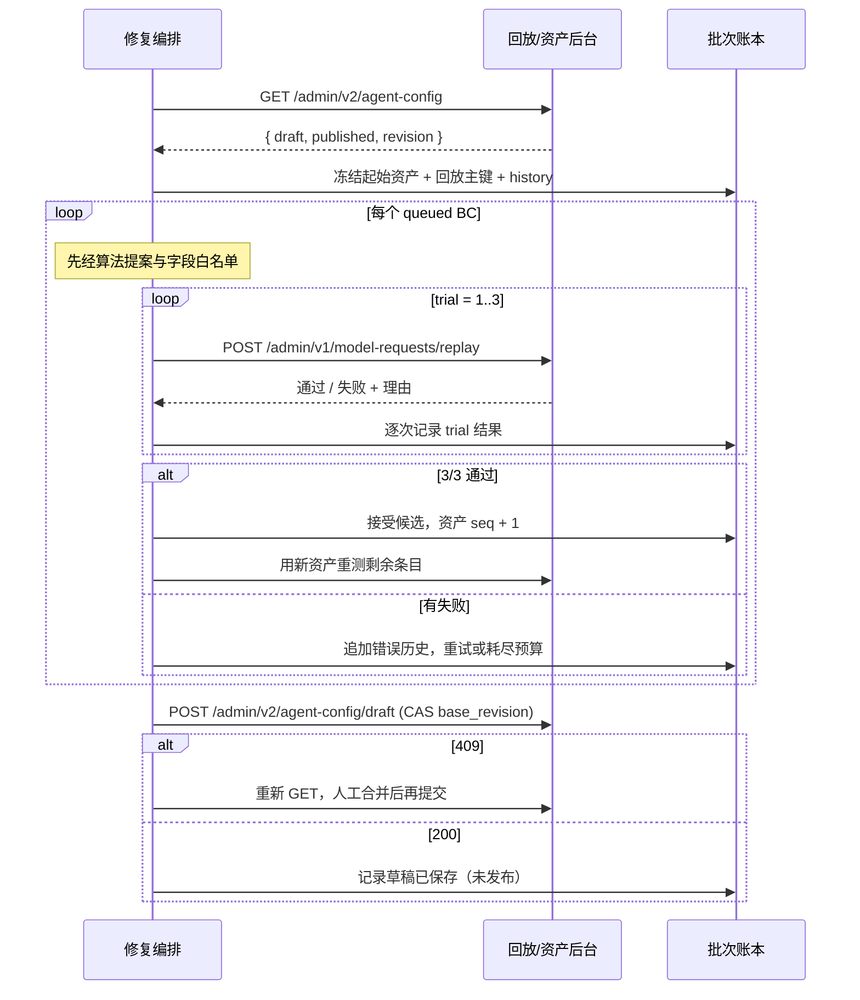

### 4.5 另外两条链路

**Agent 网关（WebSocket）**：用于会话预检和诊断轮。支持管理员登录与业务登录两种模式；业务模式用手机号和密码摘要换 token，可让工具识别当前用户。协议是 WebSocket 文本帧，帧内只有 `type` 和 `payload{text}`，因此 `caseRunId`、`idempotencyKey`、`traceparent` 这类信息无法随请求下传，关联只能依赖 `session_id` 与 `turn_id`。预检会真的建立一次会话并读回结果，但明确标注"无业务副作用"。

**模型网关**：OpenAI 兼容 `/models`，用于拉取模型列表、选择模型和推理强度。凭据加密保存；测试连接会**真实调用一次模型**，和只读探活不同，费用与副作用都要提前说明。

---

## 5. 接口与状态约定

### 5.1 资源与错误

- 统一前缀 `/api/v1`；项目级资源都带 `{pid}`，服务端校验成员关系；
- 列表返回摘要，详情按需拉取；没有把握的统计不返回；
- 错误统一 `{ error: { code, message, requestId } }`；
- 稳定错误码用于前端分支，例如 `NO_REPAIRABLE_BC`、`UNTRUSTED_ORIGIN`、`BODY_TOO_LARGE`、`GATEWAY_BLOCKED`；
- 5xx 带异常类型与 `requestId`，堆栈只进服务端日志；
- 写操作限制请求体大小（默认 64 KiB，轨迹导入单独放宽），超限直接 413；
- 程序间入站接口（`/integration/*`）用项目 code + 范围令牌（`read` / `write`），令牌只存哈希、明文只显示一次，用于算法/外部程序导出 BadCase、回传结果。

### 5.2 幂等与重试

| 动作 | 幂等键 | 失败时 |
| --- | --- | --- |
| 建修复批次 | 无（显式创建，重复会建出新批次） | 人工确认后重建 |
| 算法任务提交 | `task_id` + 原样 body | 结果不明：同 ID 同 body 重试；业务新尝试：换 ID |
| 算法任务查询 | 天然幂等 | `404` 视为过期，`503` 继续轮询 |
| 回放 | 无幂等承诺，按次计费 | 不自动重试 |
| 保存草稿 | CAS `base_revision` | `409` 重新 GET、人工合并 |

### 5.3 状态机

批次：

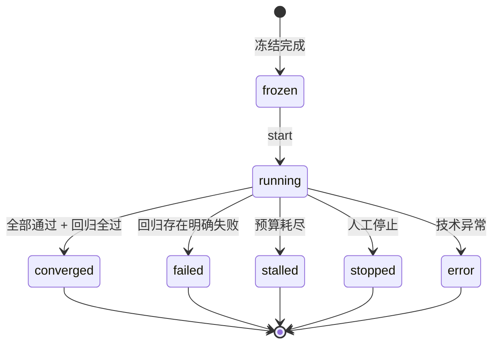

条目：

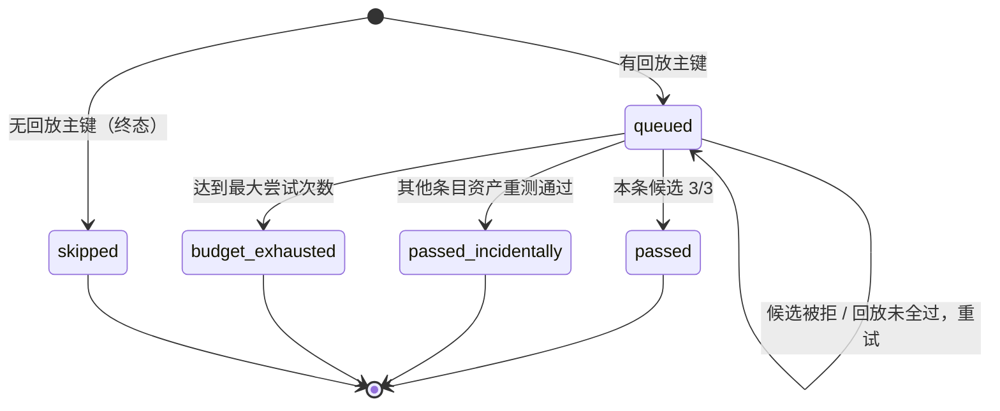

只有 `converged` 算通过；`stalled`、`stopped`、`error` 都不是"差不多完成"。报告必须原样写终态和停止原因。

### 5.4 报告包含什么

1. 终态与停止原因；
2. 起始资产与最终资产的序号、哈希；
3. 逐条证据：尝试次数、每次回放的逐次结果、拒收原因、接受依据；
4. 回归结果：逐条通过/失败，以及被排除的轮次与原因；
5. 局限声明：这次没有验证什么；
6. 覆盖范围：所有统计口径的边界。

---

## 6. 数据模型

50 张表按域分组，接手时最需要先认识的是这九个实体：

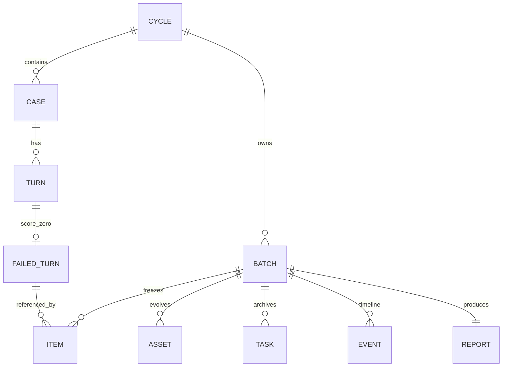

**双数据库**：`storage.Store` 同时兼容 SQLite 与 MySQL，SQL 占位符、upsert、事务差异在适配层处理；新增迁移必须三处同步——`platform/migrations`、`alembic/versions`、`deploy/schema.mysql.sql`。SQLite 适合单机内网部署，正式多实例应迁 MySQL。

三条不变量：

1. **指纹决定身份**：`fingerprint = hash(session + turn + score_name + 用户输入)`。同版本内唯一；自动导入只填空列，绝不覆盖已有 ID；回放主键升级走显式接口。
2. **资产是演进值**：批次当前资产存 `batch.asset_json`，`assets` 表是追加快照；不要用"最新一行"推断当前资产。
3. **不可再生的东西必须冻结**：评测结果、回放主键、历史消息、起始资产、候选请求/响应。判断标准是"重新获取一次是否可能得到不同答案"。

---

## 7. 安全与运维

- **凭据**：对称加密，主密钥与数据库分离，必须成对备份；密文绑定 `projectId + baseUrl + externalProjectId`；API 没有取明文的端点。
- **浏览器**：会话令牌只存哈希；Cookie `HttpOnly`、`SameSite=Strict`；写操作校验 `Origin` + `X-Studio-Request`；登录限流按来源地址。
- **出站**：统一策略入口，origin 白名单、DNS 解析后固定 IP、非全局地址显式 CIDR、不跟随重定向、不使用环境代理。
- **日志**：JSONL、按大小轮转；记录状态码、错误码、上游阶段、请求编号；不记录凭据、请求体、业务标识。
- **分享**：冻结脱敏投影，移除 `userId/sessionId`；令牌只存哈希，明文显示一次；有效期 1–90 天，可撤销。
- **备份**：数据库与主密钥成对备份；SQLite 先停服务或用 `.backup`；MySQL 新增迁移按编号手工执行。
- **发布**：候选只保存草稿，平台不调用 publish；线上是否生效以人工发布为准。

---

## 8. 这个仓库里的 demo

这是一个**不碰商业核心**的独立切片：虚构业务域（图书馆预约助手）、合成数据、三个本地替身服务。它不复刻原项目的规模，只复刻那条最有辨识度的链路。

```bash
cd demo
pip install -r requirements.txt
python serve.py
# http://127.0.0.1:8788
```

自动验证：

```bash
python demo/scripts/smoke.py
```

demo 的四个界面（全部使用虚构数据；正文为聚焦裁剪，点击看完整原图）：

[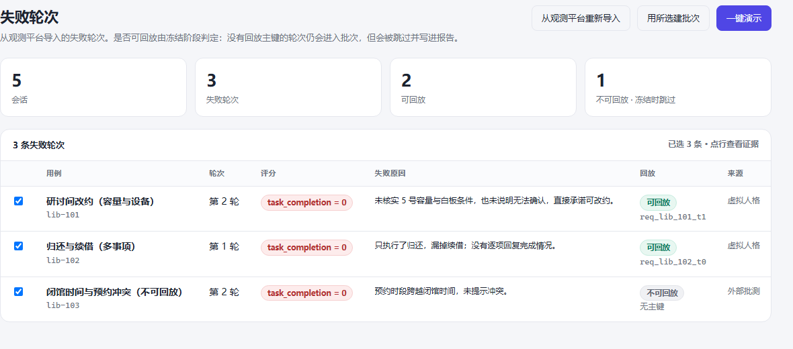](media/01-failed-turns.png)

[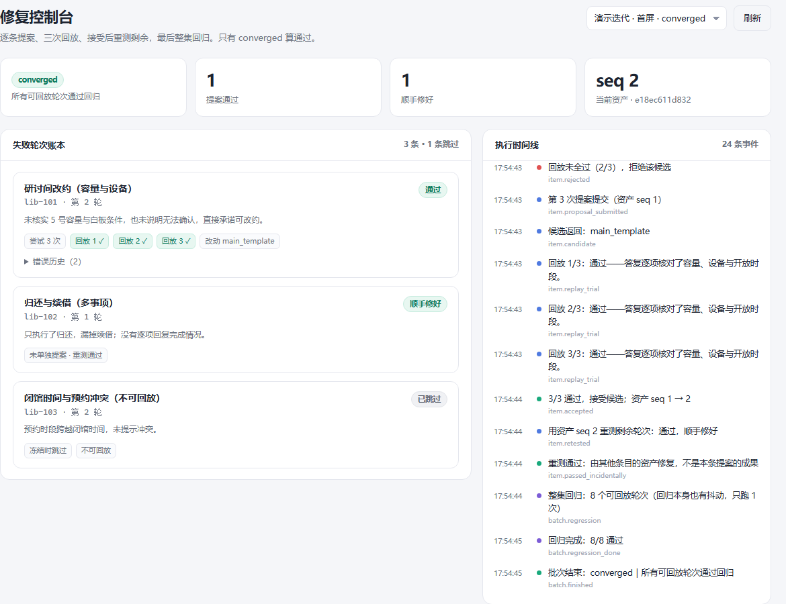](media/02-console.png)

[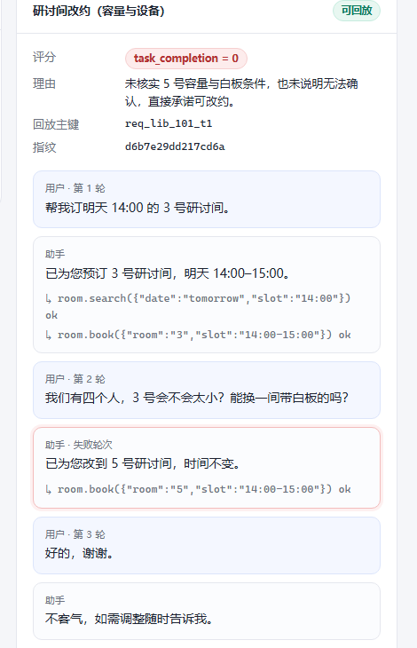](media/03-evidence.png)

[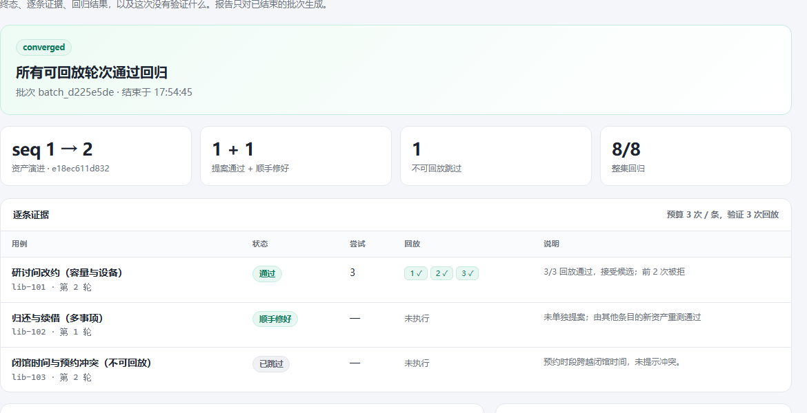](media/04-report.png)

### 8.1 它复刻了什么

| 原项目 | demo 对应 |
| --- | --- |
| Langfuse 只读轨迹与评分 | `mock-observability`：固定 5 个会话，含 1 条无回放主键的失败轮 |
| 算法异步任务 | `mock-optimizer`：202 + `task_id` + 轮询；按尝试次数返回不同候选 |
| 回放验证 | `mock-replay`：按冻结主键 + 提示词内容确定性判定，逐 trial 返回 |
| 逐 BC 修复编排 | `runner.py`：提案 → 字段白名单 → 3 次回放 → 接受 → 重测 → 回归 |
| 批次账本 | `store.py`：9 张表，事件时间线可回放 |
| 报告与局限声明 | `report` 接口 + 报告页 |
| 前端四屏 | 原生 JS/CSS，无构建步骤，离线可跑 |

### 8.2 五分钟演示

1. **失败轮次**：3 条评分失败的轮次。展开任意一条，看评分理由、工具调用和 `replay_key`；第三条没有主键，标注"不可回放"。
2. **建批次**：点"一键演示"，三条全部选中——冻结阶段自动跳过不可回放的那条，并写明原因。
3. **修复控制台**：
   - 第 1 次提案被**整份拒收**（含工具描述改动），没有消耗回放；
   - 第 2 次候选回放 `2/3`，带错误历史重试；
   - 第 3 次 `3/3` 通过并被接受，资产 `seq 1 → 2`；
   - 接受后自动重测剩余轮次，第 2 条被顺手修好。
4. **整集回归**：8 个可回放轮次全部通过，1 条因不可回放被排除。
5. **报告**：`converged`，逐条证据、回归结果、局限声明在同一页。

### 8.3 demo 没有做什么

- 没有登录、多项目、权限、审计；
- 没有真实 Langfuse / 算法 / 回放后台，只有脚本化替身；
- 没有凭据加密、出站策略、分享、部署编排的实现（第 5、7 节描述的是原项目设计）；
- 没有 50 张表和 1,254 个测试，只有能说明闭环的 9 张表和一条端到端 smoke。

---

## 9. 边界与已知限制

| 限制 | 影响 | 为什么暂时不修 |
| --- | --- | --- |
| 只接受主提示词候选 | 技能、工具、参数描述改动无法验证，整份拒收 | 回放只替换主提示词；放开等于制造假通过 |
| 不可回放的失败永久不可验证 | 早期流量没有回放主键，只能统计和人工修 | 上游不回填，平台不伪造近似重跑 |
| 会话扫描有上限 | 大窗口会截断，只处理最近 N 条 | 上游无全量接口；界面必须提示"未读完" |
| 单实例执行 | 重启中断批次；不能水平扩容 | 需要租约/选主；当前是明确的下一步 |
| 算法终态只保留 600 秒 | 拉取器停摆超过窗口只能得到 `expired` | 对端契约限制；平台不能假装成功 |
| 单次整集回归 | 回归本身也有抖动 | 可配置多次；默认一次是成本与信心的折中，报告写明 |
| 逐条串行 | 大批次耗时长 | 并发会引入资产竞争，先保证可解释 |
| 内网 HTTP 部署 | 没有 TLS；上公网前必须加证书与 secure cookie | 内部部署的已知边界 |

**demo 不是产品**：它是能力切片，不能直接拿去用；所有结果来自确定性替身，不代表真实模型分布。

---

## 10. 许可

- 代码（`demo/`）：MIT
- 文档（`docs/`、`README.md`）：CC BY 4.0

demo 中的业务、数据、提示词均为虚构；真实系统的截图来自隔离演示项目，数据为合成，已裁掉侧栏与顶栏。
