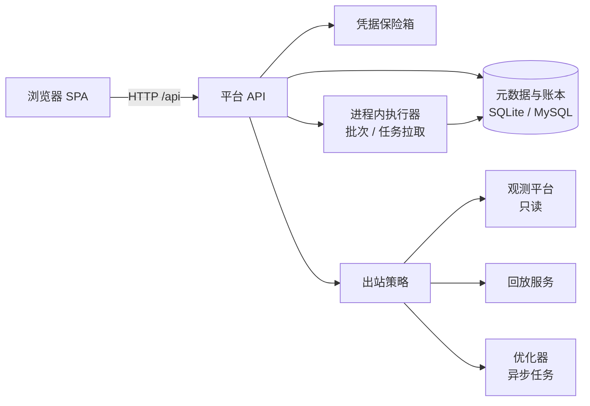

# 架构：五个部件，一条证据链

## 总体形状

五个部件各自只承担一种责任：

| 部件 | 责任 | 不做什么 |
| --- | --- | --- |
| 导入/适配 | 把上游轨迹归一成会话与失败轮次 | 不重新判分、不猜未知报文格式 |
| 领域账本 | 用例、失败轮次、批次、条目、资产、事件 | 不做外部调用 |
| 编排器 | 逐失败轮次推进状态机、重试、预算、终态 | 不决定候选好坏（由回放决定） |
| 执行/传输 | 带出站策略的外部调用、异步任务轮询 | 不静默重试不可幂等的请求 |
| 报告 | 把证据、覆盖范围、局限写成结论 | 不给"部分通过"这类发明出来的状态 |

## 为什么是"账本 + 编排"而不是"一个大服务"

修复是一个**长事务**：一条失败轮次可能经历提案、拒收、重试、三次回放、接受、重测，跨越多分钟和多个外部系统。把它写成一个同步函数，进程一重启就什么都不剩。

所以：

- 每一次状态变化先落库（`batch_items.state`、`events` 追加写）；
- 外部请求的原样请求体/响应体存档（`tasks.request_body/response_body`），复盘中不需要再调一次上游；
- 执行器只负责"读账本 → 推进一步 → 写账本"。重启后可以人工"继续"，不需要恢复内存状态。

代价是更多表、更多写操作；换来的是可复盘、可中止、可解释。

## 冻结：整个架构的支点

进入批次的对象全部冻结，而不是每次现查：

| 冻结对象 | 原因 |
| --- | --- |
| 失败轮次集合 | 批次执行期间上游数据变化不应改变结论 |
| 回放主键 | 它是唯一能把"当时那次模型请求"取回来的东西 |
| 历史消息 | 回放只替换主提示词，历史必须原样 |
| 起始资产 | 报告需要回答"从哪一版开始修的" |
| 预算与判定参数 | 事后看到的"为什么停在 stalled"必须可复现 |

冻结也意味着：**批次一旦开始，就不能换入新的失败轮次**。要修新的，建新批次。

## 单实例语义，以及为什么明说

编排器和任务拉取器都是进程内线程：

- 同一批次不会被两个副本同时执行（没有分布式锁）；
- 重启会中断执行中的批次，状态停在中途，需要人工继续；
- 这是**已知限制**，不是隐藏 bug。报告和文档都写明。

多副本需要租约/选主。异步任务账本已经具备租约语义，批次编排还没有——这是一个清晰的下一步，而不是含糊的"将来支持"。

## demo 如何映射

| 架构部件 | demo 实现 |
| --- | --- |
| 平台 API | `demo/app/main.py`（FastAPI，四组只读/写端点） |
| 领域账本 | `demo/app/store.py`（SQLite，9 张表） |
| 编排器 | `demo/app/runner.py`（线程 + 状态机） |
| 外部传输 | `demo/app/mocks.py` 的三个替身服务，走真实 HTTP |
| 报告 | `store.report()` 组装，前端渲染 |

demo 没有实现的部分（登录、多项目、MySQL、分布式执行）在 [边界](07-limits.md) 里逐条列出。

下一篇：[领域模型](02-domain-model.md)
