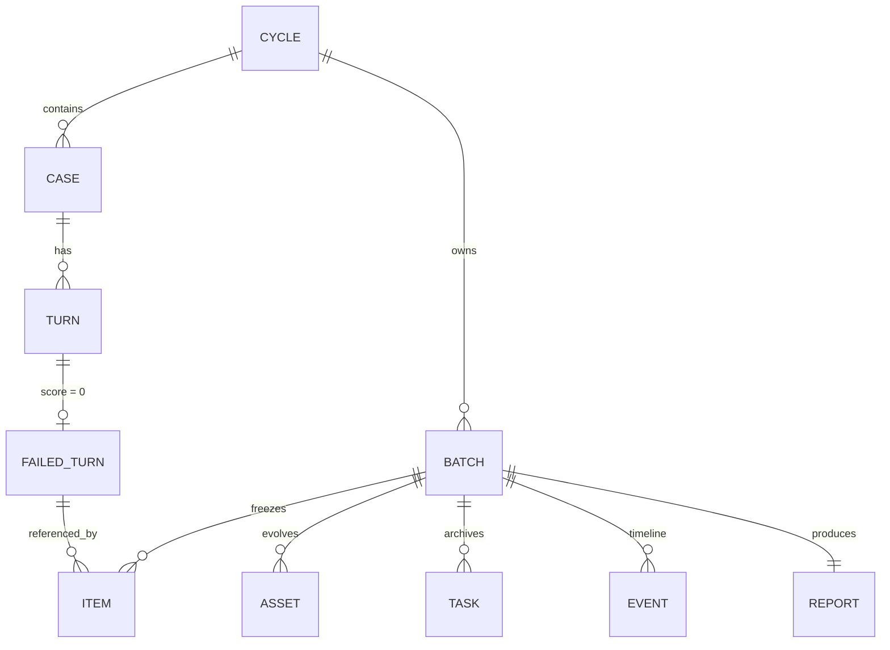

# 领域模型：九个实体与三条不变量

## 简化 ER



（demo 用 9 张表实现；内部版是 50 张，多出来的是权限、连接、数据集、分享等外围域。）

## 实体

| 实体 | 关键字段 | 说明 |
| --- | --- | --- |
| **cycle** | `name` | 一次迭代的范围容器。批次、失败轮次都挂在它下面。 |
| **case** | `source`, `turns_json` | 一条可执行脚本：单轮或多轮。来源可以是评测运行，也可以是会话导入。 |
| **turn** | `index`, `user`, `assistant`, `tools` | 一次输入/输出，附带工具调用与评分证据。 |
| **failed_turn** | `fingerprint`, `score_name`, `score_value`, `reason`, `replay_key` | 一次被判失败的**目标轮次**，带证据与可回放主键。 |
| **batch** | `status`, `stop_reason`, `max_attempts`, `asset_json` | 对一组失败轮次的一次冻结执行。 |
| **item** | `state`, `attempts`, `error_history`, `verification_json` | 批次内单个失败轮次的账本行。 |
| **task** | `request_body`, `response_body`, `status`, `polls` | 与优化器的异步任务原样存档。 |
| **asset** | `seq`, `content`, `content_hash`, `origin` | 提示词资产的演进历史。 |
| **event** | `kind`, `message`, `data_json`, `ts` | 人可读的执行时间线，也是 UI 的数据源。 |

## 三条不变量

### 1. 指纹决定身份，ID 不是身份

```text
fingerprint = sha256(session_id \x1f turn_index \x1f score_name \x1f 用户输入)
```

- 同一版本内，相同指纹只保留一条；
- 自动导入只**填空列**，绝不覆盖已有 ID；
- 需要升级回放主键时走显式操作，不由后台悄悄替换。

原因：失败轮次会被报告、批次、闭环同时引用。如果身份是可变的，所有引用都会漂移。指纹让"同一条失败"在多次导入之间保持稳定。

代价：用户输入变化会产生新失败轮次，而不是更新原记录——这是有意的，旧证据不应该被新内容改写。

### 2. 资产是演进值，不是版本表里的一行

批次当前资产存在 `batch.asset_json`，`assets` 表是**追加的快照**：

- 起始快照用于回答"从哪一版开始"与回滚；
- 每次接受候选，`seq + 1`，写入内容与哈希；
- 不要通过"最新一行"推断当前资产——批次可能被停止、回滚或复制。

原因：修复过程中资产会前进，但账本必须能解释每一次前进是谁触发的、基于哪次验证。

### 3. 不可再生的东西必须冻结

| 对象 | 可再生？ | 处理 |
| --- | --- | --- |
| 评测运行结果 | 否（真实轮次有副作用） | 存 JSON，重扫只读这份 JSON |
| 回放主键 | 否（上游只保留一段时间） | 冻结进 item |
| 历史消息 | 否（上游可能清理） | 冻结进 item |
| 起始资产 | 否（上游草稿会变） | 冻结进 batch |
| 候选请求/响应 | 否（TTL 600 秒） | 原样存档 |

判断标准很简单：**如果重新获取一次可能得到不同答案，就必须冻结。**

## 状态词汇

失败轮次（`item.state`）：

- `queued` 待处理
- `skipped` 冻结时判定不可回放（终态）
- `passed` 本条目自己的候选通过 3/3
- `passed_incidentally` 被其他条目的新资产顺手修好（重测通过）
- `budget_exhausted` 预算用尽仍未通过
- `rejected` 候选被拒（可重试，非终态）

批次（`batch.status`）：

- `frozen` 已冻结，未启动
- `running`
- `converged` / `stalled` / `failed` / `stopped` / `error`（终态，见 [修复闭环](03-repair-loop.md)）

下一篇：[修复闭环](03-repair-loop.md)
